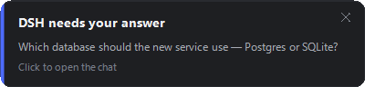
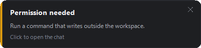
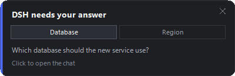
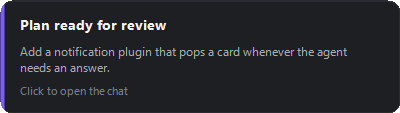
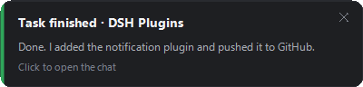
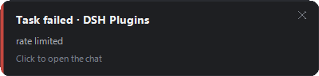

# dsh-plugin-notify

A DeepSeek Harness plugin that shows a **native desktop card whenever the agent
needs you** — because it is waiting for an answer, or because the task it was
given has finished. It tells you; you answer in the chat.

| Question | Permission prompt |
|---|---|
|  |  |

| Two questions, one card | Plan review |
|---|---|
|  |  |

| Task finished | Task failed |
|---|---|
|  |  |

## It notifies; it does not answer

The card has **no answer buttons**. Clicking it brings the chat forward, and the
answer is always given there.

That is a deliberate reversal of an earlier design that answered from the card.
The chat client owns each pending question through its own waterfall channel:

```js
const channel = this.#waterfall !== void 0 ? "waterfall" : ...
detachWaterfall(channel) {
  if (this.#waterfall !== channel) return;
  this.#waterfall = void 0;
}
// "Drop a waterfall channel that settled or was cancelled; the card stays."
```

An answer delivered out-of-band settles the *request* while leaving the client's
card on screen with nothing able to settle it — so answering from the card left
the chat asking for an action that had already been taken. A host plugin cannot
reach into that channel, so it does not answer at all.

The plugin is therefore a **pure observer**: it calls `next()` and returns
whatever the rest of the waterfall produced, so the chat behaves exactly as it
would without this plugin installed.

### How a card goes away

| You | What happens |
|---|---|
| **Click the card** | Brings the chat forward and dismisses the card. |
| **Click the ✕** | Dismisses it without switching to the chat. |
| **Answer in the chat** | The card retires on its own. |
| **Nothing** | It stays. A card never times out. |

The auto-close is worth spelling out, because it looks like answering but is not.
The plugin calls `next()` and returns it untouched; `next()` resolves when the
chat's own answerer settles the request, so a `.then` on that same promise fires
exactly when the question stops being pending. The plugin then writes a
`<cardId>.close` marker, and the card's poll picks it up and slides away. The
value returned to the waterfall is never altered, which the smoke test asserts.

## Triggers

| Trigger | Source | Card |
|---|---|---|
| `ask_user_question` | `user-questions/request` waterfall | question text, blue accent |
| Plan review (`exit_plan_mode`) | same, `intent.kind: plan-review` | purple accent |
| Permission prompt | `approval/request` waterfall | amber accent |
| Turn finished | `turn/end` session event | green accent |
| Turn failed / hit the token limit | same, by `reason.kind` | red accent |

### Task-finished notifications

There is no service for "the task is done" — the harness records it as a
`turn/end` session event carrying a reason from `TurnEndReasonMap`:

| `reason.kind` | Announced by default | Why |
|---|---|---|
| `completed` | yes | the normal "done" |
| `error` | yes | a failure matters more than a success |
| `max-tokens` | yes | it stopped early, which is worth knowing |
| `aborted`, `interrupted` | no | you stopped it yourself |
| `forked` | no | a session fork, not a user-visible task |
| `blocked` | no | the loop refused to continue; opt in if you want it |

Set `turnEndReasons` to change the set, or `turnEnd: false` to turn all of it off.

The body is the last thing the agent said — almost always the summary of what it
just did — read from the same event stream rather than from the session log, so
the plugin needs no dependency on `@deepseek-ai/dsh-session`. The heading names
the chat's working directory, because with several chats open "which one
finished?" is the first question. Each finished turn is its own card rather than
another tab on the chat's card, since it is a moment in time.

A finished turn does **not** raise a card while a question card is open for the
same chat — that card already has your attention, and a turn does not end while
`ask_user_question` is still waiting.

## One card per chat, one tab per question

A card belongs to a chat. Every pending question from that session becomes a
**tab** on its card, the way the chat UI presents them — so two questions asked
in one request are one card with two tabs, not two pop-ups. **Separate pop-ups
are reserved for separate chats.**

Grouping is by `request.agent.session.id` plus the kind of decision, so a
session's questions and its approvals never share a card. When another question
joins a chat that already has a card, the card is respawned with the extra tab,
keeping its slot on screen.

## Cards persist, and they stack

A card does **not** time out. It stays until you click it or its ✕.

When a card from another chat arrives it takes the bottom slot, pushes the
existing cards up, and each pushed card starts a countdown — shown as a bar
draining along its bottom edge — after which it closes:

```
                                    ┌──────────────────────────────┐
   pushed up, counting down ──────► │ Permission needed            │
                                    │ Run a command that writes…   │
                                    │ ▓▓▓▓▓▓▓░░░░░░░░░░░░░░░░░░░░░ │
                                    └──────────────────────────────┘
                                    ┌──────────────────────────────┐
   newest, stays until clicked ───► │ DSH needs your answer        │
                                    │ Which database should the…   │
                                    │ Click to open the chat       │
                                    └──────────────────────────────┘
```

A card that becomes the newest again — because the cards below it were dismissed
— **stops counting down and stays**. `maxStack` (default 5) closes the oldest
card immediately if a burst would exceed it.

### How the cards coordinate

Each card is its own `powershell.exe` and they cannot talk to each other, so the
plugin owns the stack and publishes it as a plain-text layout file that every
card polls:

```
<cardId>|<countdownSeconds>      one line per card, newest first
```

Index 0 is the newest card, at the bottom nearest the corner. Heights are
deliberately *not* in the file — each card writes its own `<cardId>.size`, so a
card positions itself from the real heights of the cards below it rather than
from an estimate the plugin would have to duplicate.

The file is plain text rather than JSON because the cards read it in C#, where
there is no JSON reader without pulling in another assembly.

## Install

The plugin is a normal profile bundle. From the profile directory
(`%USERPROFILE%\.dsh\profiles\desktop` for the desktop app):

```jsonc
// package.json
"dependencies": {
  "dsh-plugin-notify": "link:<absolute path to your checkout>"
},
"dsh": {
  "profile": {
    "bundles": [
      "@deepseek-ai/dsh-base",
      "@deepseek-ai/dsh-web-app",
      "dsh-plugin-notify"
    ]
  }
}
```

```sh
cd %USERPROFILE%\.dsh\profiles\desktop
pnpm install
```

The bundle's own `cordis.patch.yml` mounts the row, so no extra config row is
required. To change the defaults, add a row to the profile's own
`cordis.patch.yml`:

```yaml
- id: notify
  name: dsh-plugin-notify
  config:
    countdownMs: 30000
    sound: false
```

Restart the app to pick the plugin up. (There is no in-place reload in a
packaged build: the shell only adds a **Reload Page** menu item when running in
development. `F12` opens DevTools, from where `location.reload()` works.)

### The row name is a path, and that matters

The bundle patch mounts the row as `name: ./index.mjs` rather than the bare
package name `dsh-plugin-notify`.

`app-boot`'s `anchorInsertedPluginNames()` rewrites a relative name into a file
URL anchored beside the patch file, so the row points at the entry file directly
and does not depend on how the loader resolves a bare specifier. Both forms load,
so this is a deliberate choice for an explicit mount rather than a workaround — a
plugin linked from a checkout resolves through a symlink, and naming the file
removes any question about the resolution base.

## Configuration

| Key | Default | Meaning |
|---|---|---|
| `enabled` | `true` | Master switch; `false` unmounts every listener. |
| `questions` | `true` | React to `user-questions/request`. |
| `approvals` | `true` | React to `approval/request`. |
| `turnEnd` | `true` | Notify when a turn finishes (the `turn/end` session event). |
| `turnEndReasons` | `["completed","error","max-tokens"]` | Which `turn/end` reasons raise a card. |
| `countdownMs` | `20000` | How long a card waits after being pushed up by a card from another chat. The newest card never counts down. |
| `maxStack` | `5` | Ceiling on visible cards; past this the oldest closes immediately. |
| `sound` | `true` | Play the system exclamation sound. |
| `focusOnClick` | `true` | Clicking a card activates the Harness window. |
| `throttleMs` | `5000` | Window for suppressing an **identical** request re-dispatched in a loop. It must never gate distinct questions — see the trap below. |
| `powershell` | absolute Windows PowerShell | Interpreter that draws the card. Defaults to `%SystemRoot%\System32\WindowsPowerShell\v1.0\powershell.exe` so it does not depend on the host's `PATH`. |
| `maxBodyChars` | `220` | Body text clamp. |
| `title` | `DSH needs your answer` | Heading when a single question declares no `header` of its own. |
| `debug` | `false` | Append a diagnostic log (mount, dispatch, helper result). |
| `debugPath` | `<plugin>/debug.log` | Where that log goes; only read when `debug` is on. |

## How it works

Both question/approval seams are Cordis **waterfalls**. Waterfalls are dispatched
with an agent scope, and `dsh-scope` admits untagged listeners to every
descendant scope, so a single registration observes every agent, subagents
included.

Turn ends are not a waterfall: they are ordinary `session/event` updates, which
the same rule lets this plugin observe for every session without knowing which
agents exist.

### Why a PowerShell-drawn card instead of a Windows toast

* The DSH host runs in a **Node child process spawned by the Electron shell**
  (`dsh-desktop-host/lib/index.js`), not in the Electron main process, so
  `electron.Notification` is not reachable from a plugin.
* On Windows 11 24H2 the WinRT toast APIs reject unpackaged senders with
  `0x80073D54 "The process has no package identity"` — verified against both the
  app's registered AppUserModelID (`com.deepseek.dsh`) and an explicit process
  AUMID. A toast sender would first have to register an AppUserModelID and a
  Start Menu shortcut.

So the card is a short-lived, hidden `powershell.exe` drawing an ordinary
borderless topmost window — a rounded `Region` for the corners and
`CS_DROPSHADOW` for the shadow. See `lib/card.cs`.

An earlier version used a **layered window** (`WS_EX_LAYERED` +
`UpdateLayeredWindow`), which is the only way to get antialiased rounded corners
*and* a genuinely soft shadow. It was replaced after a long debugging session in
which it appeared never to display — a diagnosis that turned out to rest on a
broken screen-capture method (a sandboxed shell cannot composite *any* window, so
both a plain and a layered test window captured as zero pixels). The layered
version may well have been fine; this one is kept because it is simpler and
demonstrably displays.

## Traps that cost real debugging time

**Never spawn the helper `detached`.** With `detached: true` on Windows,
`powershell.exe` exits with code 0 in ~130 ms without executing a single line of
the script — no card, no error, no log entry, and no non-zero exit to notice.
Measured, everything else identical:

| `detached` | `windowsHide` | outcome |
|---|---|---|
| `true` | `true` | helper dies instantly, no card |
| `false` | `true` | card renders normally |
| `true` | `false` | helper dies instantly, no card |
| `false` | `false` | card renders normally |

**Never call `CreateGraphics()` in the form constructor.** On a `Control` it
forces handle creation, so `OnHandleCreated` runs from inside the constructor —
before the size fields exist, which makes `new Bitmap(0, 0)` throw. Use
`Graphics.FromHwnd(IntPtr.Zero)` for DPI instead. Relatedly, `Close()` is illegal
while the handle is still being created; queue it with `BeginInvoke`.

**The slide-in timer must start at 0, not 1.** The window is created parked at
`_startX = screen.Right`, just off the right edge, and a timer slides it to
`_targetX`. Initialising the progress field to `1f` means "already arrived", so
the animation is skipped and the card stays parked off-screen forever — while
every layer still reports success: the bitmap renders correctly, the window is
visible and topmost at the right size, the process exits 0, and the log names the
*target* position. The helper now logs where the window really ended up, and
`test/smoke.mjs` asserts that it equals the target.

**De-duplicate on the request, never on the chat.** An earlier version keyed its
duplicate-suppression on `session.id`, so the second question from one chat was
silently discarded as a duplicate — exactly the case the tab support exists for.
It also applied a flat 250 ms throttle that dropped it regardless. The key is now
the question ids (or the approval's callId), and the smoke test runs with the
default throttle so it cannot hide this again.

**PowerShell 5.1 guesses ANSI for a file with no BOM.** A `U+2026` ellipsis
literal in `card.cs` was read as three mojibake characters, so a truncated tab
label rendered as `…`. `card.cs`, `popup.ps1` and `test/previews.ps1` are now
pure ASCII, and `popup.ps1` reads the C# with an explicit `-Encoding UTF8`.
The preview script still exercises non-ASCII end-to-end by building its em dash
from `[char]0x2014`.

**Windows PowerShell 5.1 compiles as C# 5.** Inline `out` variables, discards
(`out _`), and string interpolation do not compile, and `Add-Type` treats
warnings as errors — so a member that hides an inherited one (`Click`, `Layout`,
`Margin`) fails the build outright.

### You cannot verify card visibility from a sandboxed shell

A DSH tool call runs under the file sandbox, and **windows created by a
sandboxed process are not composited onto the screen at all** — neither layered
nor plain. Measured: a plain borderless form filled with opaque green and a
layered form filled with opaque red, both shown from a sandboxed `pwsh`, both
produced *zero* matching pixels in a `CAPTUREBLT` screen capture. Also note that
a sandboxed shell's `$env:TEMP` is its own directory, not the host's, so scratch
files written by the host are elsewhere.

## Limitations

- **Windows only** (`os: ["win32"]` in `package.json`). The hook layer is
  portable; `lib/card.cs` and `lib/popup.ps1` are not.
- **It never answers.** By design — see the top of this file. Answering happens
  in the chat.
- **Cost per card** is one process start plus an `Add-Type` compile of ~33 KB of
  C# (~0.5 s, longer when several cards start at once). Cards are rare, so this
  is deliberate: a short-lived helper cannot leak or hang around after a crash.
- **No focus detection.** A card is shown even when the Harness window is already
  focused; the host has no reliable "is the user looking at me" signal. This
  applies to turn-end cards too, so every finished turn notifies even while you
  are reading the chat. Set `turnEnd: false`, or trim `turnEndReasons`, if that
  is too chatty.
- **A card stays until you click it.** By design. `maxStack` bounds how many can
  pile up, and pushed cards count down on their own.

## Development

```sh
node test/smoke.mjs
```

The test mounts the plugin against a fake Cordis context and asserts on the
helper's own log lines, so it fails if a card is requested but never drawn, if a
card settles off-screen, or if a two-question request does not produce one card
with two tabs. It also asserts the plugin never answers: every dispatch must
return exactly what the rest of the waterfall produced.

Re-render the previews above with:

```sh
powershell.exe -NoProfile -ExecutionPolicy Bypass -File test/previews.ps1
```

Run that under **Windows PowerShell 5.1, not `pwsh`**: the card compiles with
`-ReferencedAssemblies System.Drawing.dll`, which is right for .NET Framework but
not for PowerShell 7, where `System.Drawing` forwards to
`System.Drawing.Common` and the compile fails.

## License

MIT
